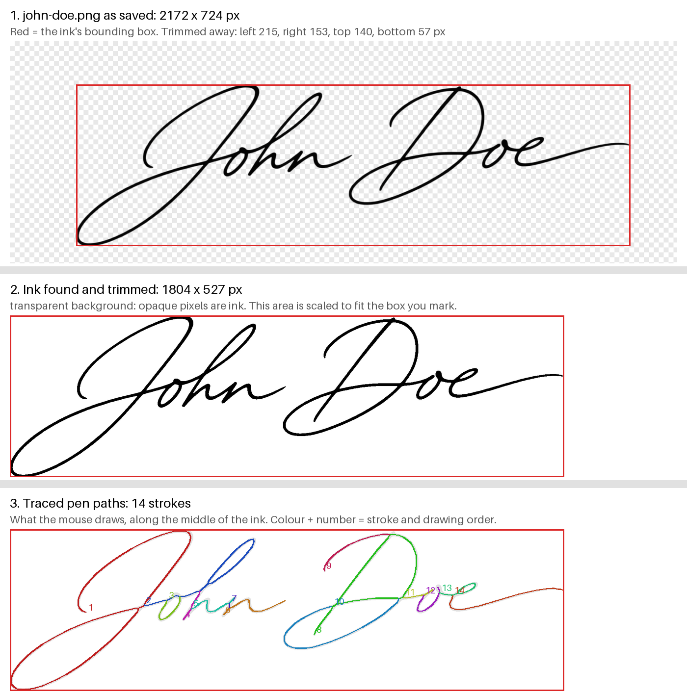

# sig-replay

Draws a stored signature on an online signature pad by tracing the image into pen
strokes and replaying them as a real mouse drag.

<div align="center">
  
</div>

- **Platform:** drawing is macOS only (it posts mouse events through Quartz). Tracing,
  `--debug` and `--svg` work anywhere Python runs.
- **Requirements:** [uv](https://docs.astral.sh/uv/). The script declares its own
  dependencies inline; `uv` installs them on first run.
- **Your own signature only.** Signature images are personal data: the `.gitignore` keeps
  all images out of the repo, so keep yours outside version control too.

## 1. One-time setup: allow your terminal to control the mouse

macOS silently drops synthetic mouse events from apps that lack the **Accessibility**
permission. The script checks this first, and if it's missing it opens the settings
page and prints these steps.

1. Open **System Settings → Privacy & Security → Accessibility**.
   Shortcut: `open "x-apple.systempreferences:com.apple.preference.security?Privacy_Accessibility"`
2. Find your terminal app (iTerm, Terminal, Ghostty, …) and switch it **on**.
   - Not listed: click **+**, choose the app in `/Applications`, switch it on.
   - Already on but still failing: select it, click **−**, then add it again with **+**.
     (An app update can leave a stale entry behind.)
3. Confirm with your password or Touch ID.
4. **Quit the terminal completely (⌘Q)** and reopen it. The permission only takes
   effect for a freshly started app.
5. Check it worked:
   ```bash
   uv run --with pyobjc-framework-Quartz python -c "import Quartz; print(Quartz.CGPreflightPostEventAccess())"
   ```
   `True` = allowed.

Toggle greyed out, or switching itself back off: the Mac is managed (Jamf/MDM) and
blocks it. Use a Mac you administer.

**When you're done signing, switch it off again.** While it's on, anything run from
that terminal can control your mouse and keyboard.

## 2. Try it with the test signature

`examples/` has a made-up "John Doe" signature for practising, in both input styles:

- `john-doe.jpg`: ink on a white background (like a scan or a photo)
- `john-doe.png`: ink on a transparent background

Open a free browser paint app such as [Kleki](https://kleki.com/), pick a thin pen, and run:

```bash
./sig_replay.py examples/john-doe.jpg --preview
```

then follow the steps in section 4. No account or sign-up needed, and nothing you draw
there goes anywhere.

## 3. Get your own signature as an image (once)

For a signature saved in Preview (Tools → Annotate → Signatures):

1. Open a blank white page in Preview. This makes one in a temp folder:
   `uv run --with pillow python -c "from PIL import Image; Image.new('RGB',(2400,1200),'white').save('/tmp/blank.png')" && open -a Preview /tmp/blank.png`
2. Insert the signature and drag it **large** (more pixels give a cleaner trace).
3. Click empty space to deselect it, so the selection handles aren't captured.
4. Press ⌘⇧4, drag a box around the signature, and keep the screenshot somewhere private,
   e.g. `signature.png`. Close the blank page without saving and delete it:
   `rm /tmp/blank.png`.

PNG or JPG both work, with or without a transparent background. This image is the only
file the tool needs, and it never writes anything next to it.

## 4. Check how it's traced

```bash
./sig_replay.py signature.png --debug
```

Opens a sheet showing each step, then exits without touching the mouse:

1. **The file as saved**, with a red box around the ink. Everything outside it (white or
   transparent space) is trimmed away; transparency shows as a checkerboard.
2. **The ink that was found**, trimmed. This is what's scaled to fit the field, so the
   signature always fills it. The caption says how ink was told from background
   (transparency, or a brightness cut-off).
3. **The traced pen paths**: what the mouse will draw, along the middle of the ink.
   Colour and number show each stroke and the order it's drawn in.

<div align="center">
  
</div>

What to look for: stray specks or a grey background showing up as ink in step 2 (set
`--threshold`, lower = stricter), or missing pieces in step 3. The sheet is a temporary
file, deleted when you press Enter. `--debug sheet.png` saves it instead.

## 5. Sign

1. Open the page with the signature field.
2. Run:
   ```bash
   ./sig_replay.py signature.png --preview
   ```
3. The trace sheet from section 4 opens. Press **Enter** if it looks right; the sheet is
   deleted straight away. Leave out `--preview` once you trust the trace.
4. Hover over the **top-left** corner of the signature field and press **Enter**. Don't
   click: the terminal keeps keyboard focus while the mouse is over the other window.
5. Hover over the **bottom-right** corner and press **Enter**. Put both corners right on the
   field's edges: the signature is scaled to fit and centred in this box, so a smaller
   box means a smaller signature.
6. During the countdown, click the target window's **title bar** (not the field) and let
   go of the mouse.
7. It draws, scaled to fit the field with its proportions kept. Done.

**Stop at any time with Esc**, even while it's drawing and the browser has focus, or by
moving the mouse yourself. Either way it releases the mouse button first.
It prints `--box x1,y1,x2,y2`; pass that to skip steps 4–5 if you need to redo it.

| Option | Default | |
|---|---|---|
| `--preview` | off | show the trace sheet (section 4) and ask before drawing |
| `--debug [FILE]` | off | show the trace sheet and exit without drawing; with a filename, save it there |
| `--svg FILE` | | write an animated SVG of the strokes being drawn and exit |
| `--speed-range` | 80,1000 | points/s for the thickest and thinnest ink: thick parts are drawn slowly, thin parts fast. Velocity-based pads (most e-sign sites: fast = thinner line) then reproduce the original's thick/thin strokes |
| `--calibrate` | off | draw six lines at 60–2000 points/s instead of the signature, to see how a pad's line width responds to speed and pick a `--speed-range` |
| `--speed` | off | constant speed in points/s instead (e.g. 300), for pads with a fixed line width |
| `--margin` | 0.03 | padding inside the field, as a fraction. Keeps the pen off the field's edge; 0.02 is fine on tall fields |
| `--lift-ms` | 60 | pause between strokes |
| `--wait` | 5 | countdown before drawing, seconds |
| `--threshold` | Otsu | ink threshold 0–255 for opaque images |

Try it on a scratch canvas first (section 2) before the real document.

## Assets

The README images are generated from the test signature:

```bash
tools/generate-readme-svg.sh   # → assets/demo-<hash>.svg, assets/trace-<hash>.png + README refs
```

- `demo-*.svg` (`--svg`): an SVG with CSS keyframes, where each traced stroke draws
  itself in order via an animated stroke dash. GitHub renders an SVG in `` with
  scripting off but declarative animation on, so it plays in the README.
  `prefers-reduced-motion` shows the finished signature, and the black ink on a white card
  reads the same in GitHub's light and dark themes.
- `trace-*.png` (`--debug FILE`): the trace sheet.

The hash in each filename busts GitHub's image cache; commit the images together with the
README. `--svg out.svg` and `--debug out.png` make the same images from any signature.
